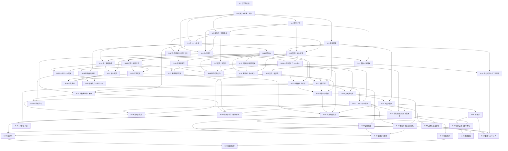

# 数学原論：予定ノートグラフ

このファイルは docs/knowledge.json の notes から生成する。この図は計画上の依存関係を表す。成立済みの個別知識は entries で確認する。

| ID | 層 | ノート | 分野 | 状態 | 直接前提 | 到達目標 |
|---|---:|---|---|---|---|---|
| N-1 | 0 | 数学的言語 | 基礎 | verified | なし | 自然言語の略記としての論理記号；制限付き量化等の略記；自然言語による論理法則・証明方法 |
| N-2 | 1 | 集合・写像・関係 | 基礎 | planned | N-1 | 外延性と集合存在の明示；部分集合・演算・直積・写像・集合族；同値関係・商集合 |
| N-3 | 2 | 選択公理 | 基礎 | planned | N-2 | 選択函数の存在を公理として採用；任意の空でない集合族の直積の非空性；全射の右逆 |
| N-4 | 2 | 順序と束 | 基礎 | planned | N-2 | 半順序・全順序・上限下限；束・完備束・分配束・Boolean束；順序保存写像 |
| N-5 | 3 | 自然数と有限集合 | 基礎 | planned | N-2, N-4 | 自然数の存在原理・帰納法・再帰；有限集合・有限列；有限選択の証明（選択公理不要） |
| N-6 | 4 | 整列と極大原理 | 基礎 | planned | N-3, N-4, N-5 | 整列集合と必要な超限帰納・再帰；Hartogs型の存在論証に必要な集合原理；整列定理・Zornの補題・選択公理の同値 |
| N-7 | 4 | 濃度と可算性 | 基礎 | planned | N-5 | 単射・全射による比較；Cantor–Bernstein・Cantorの定理；可算集合（選択を要する結果は分離） |
| N-8 | 4 | 位相空間 | 位相 | planned | N-2, N-4, N-5 | 開集合・閉集合・近傍・連続写像；部分・積・商位相；連結・分離・コンパクト性の基本（一般の積のコンパクト性は後続） |
| N-9 | 4 | モノイドと群 | 代数 | planned | N-2, N-5 | 演算・準同型・部分構造・商；自由モノイド・自由群；群作用の基本 |
| N-10 | 5 | 環と体 | 代数 | planned | N-9 | 環・イデアル・商環・体；整域・分数体・多項式環；環の局所化の基本 |
| N-11 | 6 | 整数・有理数 | 数体系 | planned | N-10, N-4 | 自然数から整数・有理数を構成；順序環・順序体；Archimedes性・整除の初歩 |
| N-12 | 7 | 実数と複素数 | 数体系 | planned | N-11 | Dedekind切断等の順序による実数構成；完備順序体の性質と一意性；複素数体の代数的構成（代数学の基本定理は後続） |
| N-13 | 8 | 距離空間 | 位相 | planned | N-8, N-12, N-3 | 距離・収束・Cauchy列・完備性；完備化・コンパクト性の距離的特徴（可算選択等を用いる証明は明示）；Banachの不動点定理 |
| N-14 | 5 | 一様空間とフィルター | 位相 | planned | N-8, N-6 | フィルター・超フィルター・一様構造；積のコンパクト性（Tychonoff）；一様完備化の基本 |
| N-15 | 6 | 有限次元線形代数 | 代数 | planned | N-10 | 有限生成線形空間・基底・次元；線形写像・行列・行列式；固有値・標準形の基礎 |
| N-16 | 6 | 加群と線形空間 | 代数 | planned | N-10, N-6 | 加群・自由加群・直和・商加群；任意次元線形空間の基底存在；PID上の有限生成加群 |
| N-17 | 7 | 多重線形代数 | 代数 | planned | N-15, N-16 | テンソル積の構成・普遍性；双対・対称代数・外積代数；有限次元の内在的な行列式 |
| N-18 | 5 | 圏と普遍構成 | 構造 | planned | N-9, N-8 | 圏・函手・自然変換；普遍性・表現可能性・極限・余極限；随伴・Yoneda（小ささの条件を明示） |
| N-19 | 7 | 有限群と表現 | 代数 | planned | N-15, N-9 | Sylow理論・組成列；群表現・指標（必要な体の条件を明示）；Maschkeの定理 |
| N-20 | 7 | 多項式と体の拡大 | 代数 | planned | N-10, N-15, N-6 | 代数拡大・超越拡大；代数閉包・分離・正規；Galois対応 |
| N-21 | 7 | 可換環論 | 代数 | planned | N-16, N-18 | Noether環・局所化・整拡大；素イデアル・次元・局所環；加群の有限性と基本構造 |
| N-22 | 9 | 実変数函数 | 解析 | planned | N-13, N-15 | 数列・級数・函数列；連続函数と一様収束；一変数微分・Riemann積分・微積分基本定理 |
| N-23 | 9 | ノルム空間と微分 | 解析 | planned | N-13, N-15 | ノルム・Banach空間・有限次元ノルムの同値；Fréchet微分・連鎖律；逆写像・陰函数定理（適切な完備性） |
| N-24 | 10 | 測度と積分 | 解析 | planned | N-22, N-3 | σ-代数・外測度・測度・可測函数；Lebesgue積分と収束定理；積測度・Tonelli・Fubini・Radon–Nikodym |
| N-25 | 11 | 位相線形空間と函数解析 | 解析 | planned | N-23, N-14, N-24 | 局所凸性・弱位相・双対性；Hahn–Banach・一様有界性・開写像；Hilbert空間・作用素・L^p空間 |
| N-26 | 10 | 複素函数論 | 解析 | planned | N-22, N-23, N-12 | 正則函数・複素積分・Cauchy理論；級数展開・留数・解析接続；代数学の基本定理 |
| N-27 | 6 | 位相群と位相環 | 構造 | planned | N-14, N-10 | 位相群・商・連続準同型；完備化・位相環・位相体；局所コンパクト群の基礎 |
| N-28 | 9 | 付値と完備体 | 構造 | planned | N-27, N-13, N-20 | 絶対値・付値・非Archimedes距離；完備化と有限拡大；局所体・Henselの補題 |
| N-29 | 12 | 調和解析 | 解析 | planned | N-25, N-27 | Haar測度（存在・一意性）；Fourier解析・畳込み；局所コンパクト可換群の双対性入門 |
| N-30 | 7 | ホモロジー代数 | 代数 | planned | N-18, N-16 | 複体・完全列・ホモロジー；射影・入射分解；導来函手・Ext・Tor |
| N-31 | 9 | 位相多様体と被覆 | 幾何 | planned | N-8, N-13, N-9 | 位相多様体・基本群・ホモトピー；被覆空間と持ち上げ；基本群と被覆の対応 |
| N-32 | 10 | 代数的位相 | 幾何 | planned | N-31, N-30 | 特異ホモロジー・コホモロジー；長完全列・切除・Mayer–Vietoris；基本的な双対性 |
| N-33 | 11 | 微分多様体と微分形式 | 幾何 | planned | N-31, N-23, N-17, N-24 | 滑らかな多様体・接空間・ベクトル束；微分形式・外微分・分割の一；多様体上の積分・Stokesの定理 |
| N-34 | 12 | 微分幾何 | 幾何 | planned | N-33 | 接続・曲率・測地線；Riemann計量・距離；基本的な幾何学的変分 |
| N-35 | 12 | Lie群とLie環 | 幾何 | planned | N-33, N-27 | Lie群・Lie環・指数写像；随伴表現・部分群；Lie環の構造と基本表現 |
| N-36 | 8 | 代数幾何 | 幾何 | planned | N-21, N-20, N-51 | Zariski位相・Specと構造層；局所環付き空間・アフィンスキーム・スキーム；スキームの射・準連接層の基本 |
| N-37 | 11 | 代数的整数論 | 代数 | planned | N-21, N-28, N-15, N-24 | 整数環・Dedekind整域・イデアル分解；分岐・局所化・完備化；数体の基本定理（Minkowski型の幾何的補題を必要時導入） |
| N-38 | 7 | 組合せ論とグラフ理論 | 離散 | planned | N-11, N-9 | 数え上げ・母函数の形式的利用；グラフ・木・連結性；群作用による数え上げ |
| N-39 | 10 | 微分方程式と力学系 | 解析 | planned | N-23, N-22 | 常微分方程式の存在・一意性；流れ・安定性；線形系・変分方程式 |
| N-40 | 13 | 偏微分方程式 | 解析 | planned | N-25, N-29, N-39 | 分布・Sobolev空間；弱解と変分法（必要な基本原理を本ノートで導入）；楕円型・発展方程式の基本 |
| N-41 | 11 | 確率論 | 応用 | planned | N-24 | 確率空間・確率変数・独立性；条件付き期待値・大数法則・中心極限定理（必要な特性函数の補題を導入）；離散時間マルチンゲール |
| N-42 | 12 | 確率過程と確率解析 | 応用 | planned | N-41, N-25 | 確率過程の構成・Brown運動；確率積分・Itô公式；確率微分方程式 |
| N-43 | 12 | 凸解析と最適化 | 応用 | planned | N-23, N-25 | 凸函数・分離・凸双対；有限次元最適性条件・制約問題；勾配法・近接法 |
| N-44 | 13 | 変分学 | 応用 | planned | N-43, N-33, N-39 | 函数空間上の極値・変分；Euler–Lagrange方程式；直接法と必要なコンパクト性 |
| N-45 | 14 | 数理力学 | 応用 | planned | N-44, N-34 | Lagrange・Hamilton形式；シンプレクティック構造・保存則；力学の幾何学的構成 |
| N-46 | 13 | 数理金融 | 応用 | planned | N-42, N-43 | 無裁定・価格付け・測度変換；Black–Scholes型モデル；ポートフォリオ最適化 |
| N-47 | 5 | 計算可能性と形式言語 | 数学の研究 | planned | N-5, N-9 | 文字列・形式言語・再帰函数；計算モデル・決定可能性；停止問題 |
| N-48 | 6 | 数理論理学 | 数学の研究 | planned | N-47, N-10 | 形式的構文・意味論・証明体系；完全性・モデル理論の基本；算術の形式化と不完全性 |
| N-49 | 7 | 現代的集合論 | 数学の研究 | planned | N-48, N-6, N-7, N-14 | ZF・ZFCの形式的記述；順序数・基数・超限再帰の発展；モデル・相対的無矛盾性・強制法入門 |
| N-50 | 13 | 数理モデリング | 応用 | planned | N-41, N-43, N-39, N-38 | 現象の抽象化・モデル設計・推定の基礎；ネットワーク・動的システム・意思決定；社会システム等への応用とモデル検証 |
| N-51 | 6 | 層の理論 | 構造 | planned | N-18, N-10 | 開集合の圏・前層・層の局所性と貼り合わせ条件；切断・芽・茎・層化の普遍性・茎による同型判定；エタール空間との対応（集合値の層）・逆像層と順像層・随伴；定数層・群の層・環の層・環付き空間 |
| N-52 | 8 | 層係数コホモロジー | 構造 | planned | N-51, N-30 | Abel群の層・環の層上の加群・茎での完全性；大域切断函手・入射分解の存在・右導来函手としての層係数コホモロジー；Čechコホモロジーと比較（成立条件を明示）・弛緩層と非輪状分解；局所から大域への障害・連結準同型と長完全列 |
